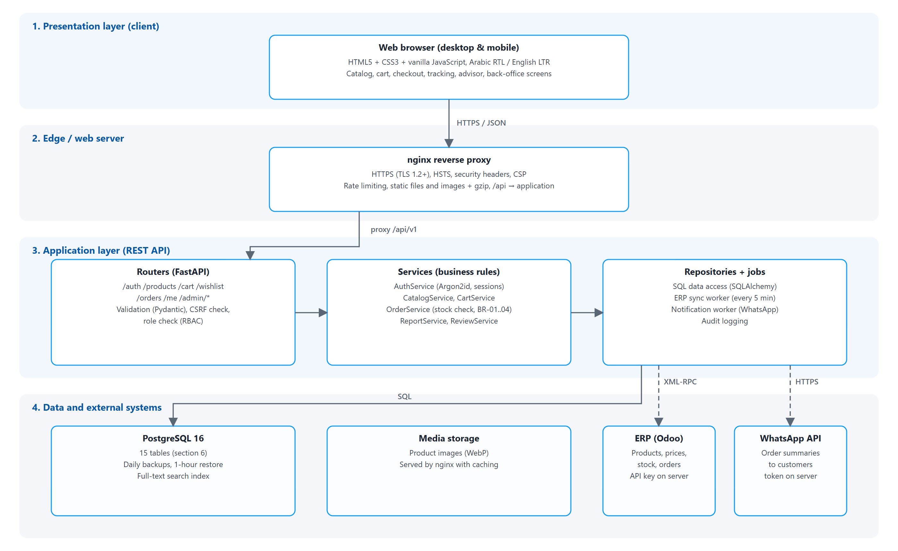

# Muscle Mania Online Store

Bilingual (Arabic / English) online store for sports supplements and sportswear: catalog, search and filters, cart, cash-on-delivery
checkout, order tracking, nutrition advisor, exercise library, and a back office for employees and administrators.

Course Project, Phase 2. The full Software Requirements Specification is in [`docs/SRS.pdf`](docs/SRS.pdf).

## Team

| Member | Role |
|---|---|
| Murad | Team Leader / Spokesperson, Backend |
| Member 2 | Frontend |
| Member 3 | Database & Integration |
| Member 4 | QA & Documentation |

## Architecture

Layered client-server architecture (SRS section 9):

```
frontend/   static HTML, CSS and JavaScript, Arabic RTL / English LTR
backend/    REST API, Python 3.12 + FastAPI (routers -> services -> repositories)
database/   PostgreSQL 16 schema and seed data
docs/       SRS, OpenAPI specification, diagrams
```



## Run locally

```bash
# database
createdb muscle_mania
psql -d muscle_mania -f database/schema.sql
psql -d muscle_mania -f database/seed.sql

# backend
cd backend
python -m venv .venv
.venv/Scripts/activate        # Windows  (macOS/Linux: source .venv/bin/activate)
pip install -r requirements.txt
copy ..\.env.example ..\.env  # then fill in your own values
uvicorn app.main:app --reload

# frontend: open frontend/index.html, or serve it
python -m http.server 8000 --directory ../frontend
```

API docs are generated by FastAPI at http://127.0.0.1:8000/docs. The endpoints are specified in `docs/api/openapi.yaml`;
in Phase 2 they return `501 Not Implemented` and are built in the sprints planned in Jira.

## Workflow

- Jira project key: **MM**. Every branch and commit starts with its ticket key, for example `MM-15-cart-stock-limit`.
- `main` is protected: changes go through pull requests reviewed by one other member.
- Secrets never go in the repository. Copy `.env.example` to `.env` (ignored by git).
